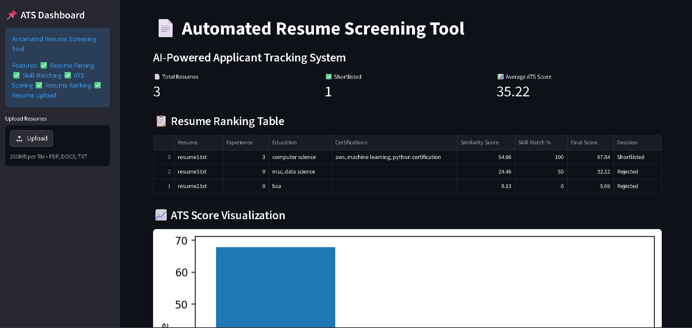
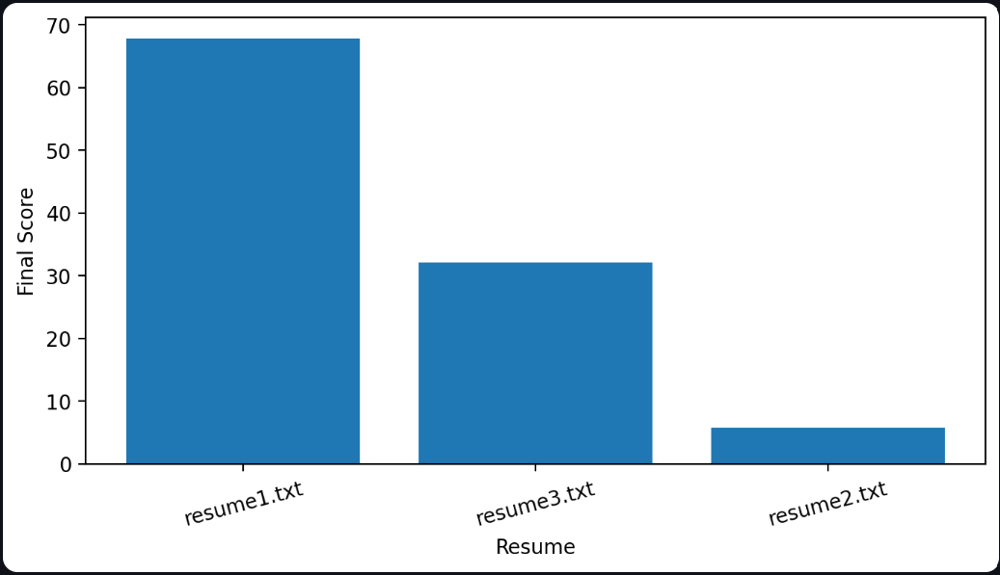
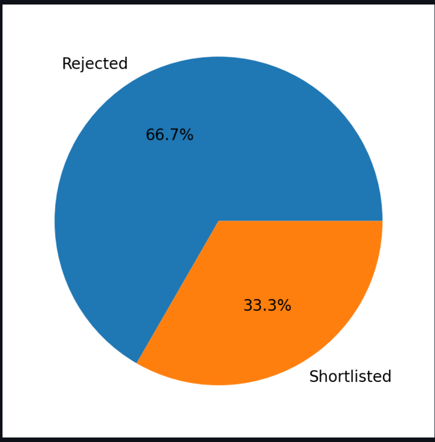
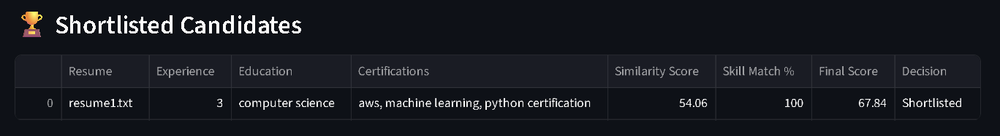

# 📄 AI-Powered Automated Resume Screening Tool

## 🌐 Live Demo

🔗 Live Application: [https://automated-resume-screening-tool-kx5pos8edaztdwaufepjww.streamlit.app/](https://automated-resume-screening-tool-kx5pos8edaztdwaufepjww.streamlit.app/)

🔗 GitHub Repository: [https://github.com/Vayu-143/Automated-Resume-Screening-Tool](https://github.com/Vayu-143/Automated-Resume-Screening-Tool)

---

# 🚀 Project Overview

The **AI-Powered Automated Resume Screening Tool** is an industry-oriented Applicant Tracking System (ATS) simulation developed using Python, NLP techniques, TF-IDF Vectorization, Cosine Similarity, and Streamlit.

This project automatically screens and ranks resumes based on job descriptions and required skills, similar to how real-world ATS systems work in companies and HR departments.

The system extracts resume data, detects skills, experience, education, and certifications, calculates ATS scores, ranks candidates, and generates visual reports through an interactive dashboard.

---

# 🎯 Problem Statement

Recruiters and HR teams receive hundreds or thousands of resumes for a single job opening.

Manual screening:

* Takes significant time
* Is repetitive and inefficient
* Can lead to inconsistent shortlisting

This project solves the problem by automating resume screening using NLP and machine learning techniques.

---

# 🏢 Industry Relevance

This project demonstrates practical implementation of:

* Applicant Tracking Systems (ATS)
* Resume Parsing
* NLP-based Matching
* Automated Candidate Ranking
* HR Tech Automation
* AI-powered Recruitment Systems

It is highly relevant for:

* Python Developer Roles
* Data Analyst Roles
* AI/NLP Projects
* Automation Projects
* HR Tech Solutions
* Portfolio and Internship Applications

---

# ✨ Features

✅ Resume Parsing

✅ PDF Resume Extraction

✅ DOCX Resume Extraction

✅ TXT Resume Extraction

✅ Text Cleaning and Preprocessing

✅ Skill Extraction

✅ Experience Detection

✅ Education Detection

✅ Certification Detection

✅ TF-IDF Vectorization

✅ Cosine Similarity Matching

✅ ATS Score Calculation

✅ Resume Ranking

✅ Candidate Shortlisting

✅ CSV Report Generation

✅ Interactive Streamlit Dashboard

✅ Resume Upload Feature

✅ ATS Score Visualization

✅ Selection Ratio Pie Chart

✅ Downloadable ATS Report

✅ Cloud Deployment using Streamlit

---

# 🛠️ Tech Stack

| Technology   | Purpose                    |
| ------------ | -------------------------- |
| Python       | Core Programming Language  |
| Pandas       | Data Processing            |
| Scikit-learn | TF-IDF & Cosine Similarity |
| Streamlit    | Dashboard UI               |
| Matplotlib   | Data Visualization         |
| pdfplumber   | PDF Text Extraction        |
| python-docx  | DOCX Resume Extraction     |
| Regex        | Text Parsing               |
| Git & GitHub | Version Control            |

---

# 🧠 NLP Concepts Used

## TF-IDF Vectorization

TF-IDF (Term Frequency-Inverse Document Frequency) converts resume text and job descriptions into numerical vectors.

It identifies important keywords while reducing the impact of common words.

---

## Cosine Similarity

Cosine Similarity measures similarity between:

* Resume Content
* Job Description

Higher similarity scores indicate better matching candidates.

---

# ⚙️ System Workflow

```text
Resume Upload
      ↓
Resume Text Extraction
      ↓
Text Cleaning
      ↓
Skill Extraction
      ↓
Experience Detection
      ↓
Education Detection
      ↓
Certification Detection
      ↓
TF-IDF Vectorization
      ↓
Cosine Similarity Calculation
      ↓
ATS Score Generation
      ↓
Resume Ranking
      ↓
Shortlist / Reject Decision
      ↓
CSV Report Generation
```

---

# 📂 Project Structure

```bash
Automated-Resume-Screening-Tool/
│
├── resumes/
│   ├── resume1.txt
│   ├── resume2.txt
│   └── resume3.txt
│
├── outputs/
│   └── resume_ranking.csv
│
├── images/
│   ├── dashboard.png
│   ├── bar_chart.png
│   ├── pie_chart.png
│   └── shortlisted.png
│
├── data/
│   └── job_description.txt
│
├── src/
│   ├── cleaner.py
│   ├── extract_text.py
│   ├── file_handler.py
│   ├── matcher.py
│   ├── parser.py
│   └── skill_extractor.py
│
├── app.py
├── main.py
├── requirements.txt
├── README.md
└── .gitignore
```

---

# ⚡ Installation Guide

## 1️⃣ Clone Repository

```bash
git clone https://github.com/Vayu-143/Automated-Resume-Screening-Tool.git
```

---

## 2️⃣ Navigate to Project Folder

```bash
cd Automated-Resume-Screening-Tool
```

---

## 3️⃣ Create Virtual Environment

### Windows

```bash
python -m venv venv
venv\Scripts\activate
```

### Mac/Linux

```bash
python3 -m venv venv
source venv/bin/activate
```

---

## 4️⃣ Install Dependencies

```bash
pip install -r requirements.txt
```

---

# ▶️ Run Application

## Run Streamlit Dashboard

```bash
streamlit run app.py
```

---

# 📊 Dashboard Features

The dashboard provides:

* Resume Ranking Table
* ATS Score Visualization
* Selection Ratio Pie Chart
* Resume Upload Feature
* Shortlisted Candidates Table
* Downloadable ATS Reports

---

# 📸 Screenshots

## Dashboard



---

## ATS Score Visualization



---

## Selection Ratio



---

## Shortlisted Candidates



---

# 📈 Sample Output

| Resume      | Final Score | Decision    |
| ----------- | ----------- | ----------- |
| resume1.txt | 67.84       | Shortlisted |
| resume3.txt | 32.12       | Rejected    |
| resume2.txt | 5.69        | Rejected    |

---

# 🔍 ATS Scoring Logic

The final ATS score is calculated using:

```python
final_score = (
    similarity_score * 0.7
    + skill_match_percentage * 0.3
)
```

Where:

* 70% weight = Resume similarity score
* 30% weight = Skill matching percentage

---

# 🧪 Testing and Simulation

The project uses:

* Sample resumes
* Synthetic candidate profiles
* Job descriptions
* Skill matching logic

This simulates how real ATS systems process applications.

---

# 📚 Learning Outcomes

Through this project, I learned:

* Natural Language Processing (NLP)
* Resume Parsing
* TF-IDF Vectorization
* Cosine Similarity
* Regex-based Information Extraction
* Python Automation
* Streamlit Dashboard Development
* Data Visualization
* Git & GitHub Workflow
* Cloud Deployment

---

# 🔮 Future Improvements

Potential future upgrades:

* AI-based Resume Recommendations
* Multiple Job Description Support
* Advanced NLP using spaCy
* Resume Feedback System
* MongoDB Database Integration
* Authentication System
* Admin Dashboard
* Flask/FastAPI Backend
* OpenAI API Integration

---

# 💼 Interview Explanation

## Explain Your Project

"I built and deployed an AI-powered Automated Resume Screening Tool that simulates how real ATS systems work.

The system extracts resume text from PDF, DOCX, and TXT files, cleans the data using NLP preprocessing techniques, extracts skills, education, certifications, and experience using Regex-based parsing, then compares resumes with job descriptions using TF-IDF vectorization and cosine similarity.

It calculates ATS scores, ranks candidates, shortlists suitable applicants, generates downloadable reports, and visualizes results using an interactive Streamlit dashboard deployed on the cloud."

---

# 📌 Use Cases

This project can be used for:

* HR Automation
* Resume Screening
* Candidate Ranking
* Recruitment Workflow Automation
* AI-based Hiring Systems
* Educational NLP Projects

---

# 👨‍💻 Author

## Vayunandan Mishra

🔗 GitHub: [https://github.com/Vayu-143](https://github.com/Vayu-143)

🔗 Project Repository: [https://github.com/Vayu-143/Automated-Resume-Screening-Tool](https://github.com/Vayu-143/Automated-Resume-Screening-Tool)

🔗 Live Demo: [https://automated-resume-screening-tool-kx5pos8edaztdwaufepjww.streamlit.app/](https://automated-resume-screening-tool-kx5pos8edaztdwaufepjww.streamlit.app/)

---

# ⭐ If you found this project useful, consider giving it a star on GitHub.
